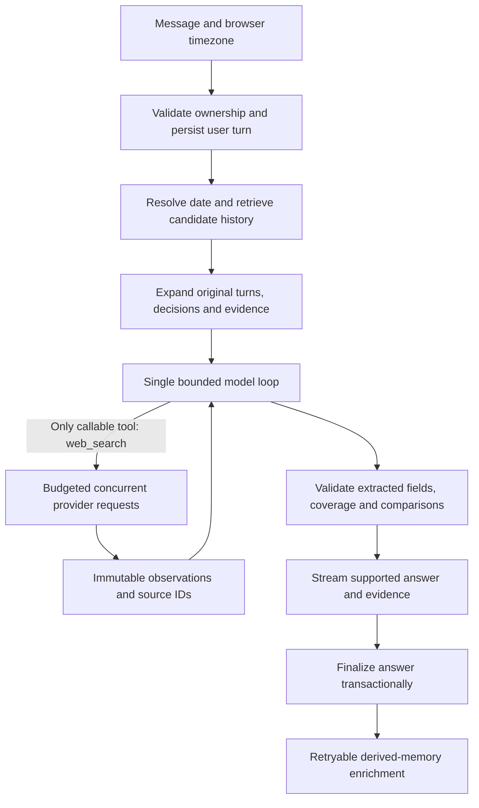

# Detailed implementation plan

Version 0.1 — 12 November 2026 — PROPOSED, NOT APPROVED FOR IMPLEMENTATION.

## 1. Product outcome and constraints

We are building a general conversational agent with durable, date-aware memory and evidence-based revalidation. A representative task is: “On Monday we shortlisted five CRM tools for a 20-person sales team. Have prices changed, or has anything important shipped?”

A successful answer must recover the correct five tools and original constraints, retrieve what the assistant actually recommended, inspect current evidence for each relevant claim, distinguish observation from proven change, and explain the practical effect on that team. Ordinary conversation and new web research must also work.

The supplied research reconstructs these submission requirements: JavaScript/TypeScript on Node, `npm install`, `npm run dev`, exactly one model-callable tool (web search), `.env.example`, public GitHub repository, one-page DESIGN.md and a one-minute video. Before architecture freeze, re-read the original [challenge](https://app.notion.com/p/minimi-hiring-challenge-build-a-chat-agent-4100a8b933b181b98277d8ea5a534d6f) and [application](https://binary.so/YIrD8L5), retaining the wording and review date. The interpretation of hidden grading remains unknown.

Application-side database recall and validation will not be exposed as model-callable tools. Search-provider content returned with a search stays within the single web_search tool. No browser, shell, memory MCP or separate fetch tool will be exposed to the model. This is the conservative boundary proposed in the research, not an official clarification from the challenge authors.

## 2. What differentiates the proposed system

Memory, dated recall, citations, SQLite, parallel search and claim ledgers are existing baseline capabilities. Our testable improvement hypotheses are:

1. Complete recovery of original shortlists and constraints, even after revisions or background extraction delays.
2. Claim-level coverage: every relevant item has a supported conclusion or an explicit unknown.
3. Comparisons that reject different plans, billing terms, currencies and usage units.
4. Separate conclusions for observed differences, proven change dates, identical endpoints and originally incorrect answers.
5. Inspectable supporting excerpts and dates rather than only working citation links.
6. Lower avoidable latency through a short ordinary-chat path and bounded concurrent research.

These are hypotheses to validate, not uniqueness or performance claims. REPOSITORY_REVIEW.md defines what we must inspect before deciding whether a hypothesis addresses an actual gap.

## 3. Proposed stack and scope

| Component | Proposal | Reason / decision gate |
| --- | --- | --- |
| Language/runtime | TypeScript, Node LTS; provisionally Node 24+ | One language, strict contracts; confirm current support and SQLite behavior before lock-in. |
| HTTP | Small Express server with SSE | Transparent lifecycle and cancellation; reconsider Hono only if source review reveals a concrete benefit. |
| Browser | React + Vite, restrained chat interface | Readable answers, history and evidence inspection without a large product shell. |
| Storage | SQLite with transactions and FTS5 | Local persistence, date/lexical retrieval, no external service. Confirm built-in driver suitability before implementation. |
| Dates | Injectable clock, IANA timezone, date library selected after documentation review | Calendar windows must be deterministic across timezone boundaries. |
| Model | One configurable primary tool-calling model | Select exact provider/model through later evaluation, not competitors' advertised scores. |
| Search | One adapter contract; Exa and Tavily are candidates | Select one default after a comparable provider pilot; no initial fallback chain. |
| Validation | Runtime schemas, planned library choice before freeze | Structured output can fail despite TypeScript types. |
| Checks | Unit/integration runner and browser checks selected at implementation approval | Test invariants, actual behavior and regressions; avoid tests that only mirror code. |

Defer graph databases, managed memory services, agent swarms, MCP exports, recurring monitors, voice, uploads and elaborate visual polish. Add semantic retrieval only if held-out paraphrase misses justify its ingestion cost and latency. A simple agent loop is preferred over a framework unless the framework review changes an explicit requirement or materially simplifies lifecycle management.

## 4. System flow and trust boundaries

The diagram is conceptual. Validation can occur between search rounds; final unsupported conclusions must not be streamed before checks finish. Progress events can stream earlier. External text is data, regardless of whether it comes from web results, imported chats or old assistant messages.

## 5. Storage model and invariants

Design the following conceptual records before creating SQL or code:

| Record | Essential information |
| --- | --- |
| Workspace / conversation | Owner scope, IDs, title, creation time. |
| Message / turn | Role, original content, conversation ID, UTC timestamp, original timezone, run ID, completion state. |
| Decision / shortlist | Exact member IDs, ordered membership if meaningful, constraints, original turn IDs, supersession relationship. |
| Source observation | URL, title, returned excerpt/content, provider, retrieval time, capture time if supplied, publication/effective dates if supported, hash, acquisition status. |
| Claim | Entity, attribute, proposed value, comparison dimensions, original text span, source-observation links, extraction/validation state. |
| Verification run | Baseline references, request time, obligations, searches, timings, budgets, failures, coverage and final outcomes. |
| Derived index / job | Date/FTS/entity keys; extraction version, pending/complete/failed state, retry count. |

Invariants:

- Persist the user's question before provider calls. A crash must not erase it.
- Completed original messages and source observations are immutable; corrections append records and link superseded claims.
- Observation time, publication time and effective time are separate and nullable. Never fill unknown dates with retrieval time.
- Store the actual evidence text, not only a URL or hash. A hash cannot reconstruct evidence.
- Extracted memories are rebuildable indexes. They never replace the original messages.
- Partial, cancelled and failed answers cannot silently become completed factual memory.
- Scope every retrieval and citation lookup by workspace owner. A browser ID is local isolation, not production authentication.
- Rebuild and deletion behavior must account for indexes, claims, source links and pending jobs; deleting a conversation must not leave searchable orphan memories.

## 6. Recall design

1. Normalize the request against the current injected clock and user timezone. Store absolute UTC boundaries corresponding to the requested local calendar dates.
2. Distinguish historical reference dates from “today” in a freshness request. “Still correct today” must not replace the requested historical date.
3. For ambiguous weekdays, retain plausible windows. Use topic/entity matches to narrow candidates. If multiple relevant exchanges remain, ask one precise clarification.
4. Retrieve by date, FTS, named entities and current-thread references. Broaden in stages when matches are weak; do not silently drop the date requirement.
5. Rank compact candidates, then expand original messages and all linked shortlist members, constraints and source observations.
6. Return scope metadata: windows searched, candidates found, included count, truncation, pending extraction and missing source evidence.
7. Retrieve immediately from raw messages if enrichment has not finished. For broad questions, paginate or disclose the bounded scope.
8. If no baseline is recovered, say “No matching saved record was found within this scope.” Do not invent the five vendors or infer that the conversation never happened.

Measure exact-turn retrieval, shortlist set recovery and constraint recovery independently of final prose. Add embeddings only after identifying specific lexical failures on development cases, then confirm improvements on untouched cases.

## 7. One-tool search and orchestration contract

The proposed web_search input is a bounded query batch with per-query purpose, optional domain/date constraints and freshness intent. Its output contains query IDs, provider status, observations, acquisition/capture metadata and explicit failures. Search provider schema details remain an adapter concern and must be verified against official documentation before implementation.

Initial tunable bounds: up to 3 research rounds, 12 queries per turn, concurrency 3, 4 main-loop model calls and a 120-second hard deadline. These are starting ceilings, not a speed target; tune against the latency evaluation. Enrichment gets a separate bounded budget.

Routes are behavioral paths, not an obligatory extra planner model:

- Casual chat: current context, normally one model call, no search.
- Pure historical recall: retrieve and answer from originals, no web search unless requested.
- New current-world research: bounded search and source-supported answer.
- Revalidation: recover baseline, construct obligations, require current evidence, compare.

Use one abort signal across model, searches and SSE disconnects. Retry transient failures at most once within the total deadline, and only when useful. Exhausted budgets produce partial coverage with explicit unknowns. Track costs and timings without persisting secrets or sensitive full prompts in ordinary logs.

## 8. Revalidation pipeline

### A. Establish baseline

Recover the old assistant answer, exact relevant decisions and original evidence. Distinguish “the assistant said X” from “a source established X at that time.” An imported answer with only a URL is a weaker baseline; mark the missing historical content.

### B. Create obligations

Each shortlist member may have separate price, limit, availability and relevant-release obligations. Record independently: search attempted, usable evidence acquired, comparison prerequisites met, verdict resolved. A query containing an entity name satisfies only the attempt stage.

### C. Acquire two types of evidence

- Current state: official pricing/product pages, requesting fresh acquisition when supported. Do not exclude these pages merely because their publication date is old or unknown.
- Changes: dated official announcements/changelogs covering the baseline-to-now interval.

Prefer primary sources, but retain conflicts and missing information. Search snippets are sometimes insufficient for qualifiers; request provider-supplied fuller content inside the same tool contract. If the provider cannot acquire it, mark the gap rather than silently adding a second tool.

Historical snapshots are optional baseline recovery, not assumed coverage. Inspect capture dates and plan content. A snapshot selected “as of” a date may be older than that date and may not establish the required historical state. Matching endpoints do not prove continuous stability.

### D. Normalize comparable claims

For prices, preserve vendor, product, plan, currency, region, amount, pricing unit, billing interval, annual commitment, seats, minimum purchase, tax basis, usage allowance and promotion state where relevant. Every extracted value links to an evidence span; unknown fields stay unknown.

Code validates prerequisites and computes totals. Example: $20 per user/month with annual billing versus $25 per user/month with monthly billing is not evidence of a 25% price increase. Do not perform automatic currency conversion or assume taxes, discounts or seat minimums. For qualitative launches, explain relevance to the remembered team constraints using dated evidence.

### E. Apply explicit verdicts

| Verdict | Preconditions |
| --- | --- |
| Confirmed change after baseline | Comparable values differ and reliable timing evidence places the transition after baseline. |
| Different now; timing unknown | Comparable historical/current evidence differs, but transition timing is unestablished. |
| Same observed value | Comparable evidence matches at the two observations; continuous stability is not established. |
| Earlier answer was wrong | Reliable historical evidence contradicts the original answer at or before its date. |
| Cannot compare / verify | Missing baseline/current evidence, incompatible dimensions or unresolved conflicts. |
| No matching saved baseline | Recall failed within the disclosed lookup scope. |

A model proposes extraction and interpretation. Code restricts statuses according to available validated fields; qualitative support still needs review and cannot be guaranteed by schema validation.

## 9. Answer and interface contract

A recheck begins with the recovered baseline date and constraints, followed by the useful conclusion. Present an item-level comparison with prior observation, current observation, outcome and evidence. Explain missing coverage and why meaningful changes matter to the user's original decision.

The interface needs streaming, stop/retry, conversation history, visible timezone, inspectable recalled exchange, and source cards with excerpts and observation/capture/publication dates where available. Avoid displaying implementation internals in ordinary conversation. Diagnostic detail belongs in an optional inspector.

Citation validation has two layers: IDs must resolve to observations in the current owner scope; cited passages must support the associated claim and comparison dimensions. Quote references can guarantee insertion of a stored passage, not truth or continued exactness of a live page. Use deterministic quote insertion only for actual direct quotations.

## 10. Build sequence after approval

Effort ranges are provisional focused working days; adjust for provider access, source-review findings and the unknown submission deadline. No phase below starts before the approval gate.

| Phase | Work | Exit evidence | Estimate |
| --- | --- | --- | --- |
| 0: research and freeze | Inspect prioritized clones; verify brief; settle contracts, versions, provider pilot procedure and evaluation rubric | Completed decision checklist and explicit user approval | Planning phase; before code |
| 1: runnable foundation | Config, HTTP/SSE, model adapter, single validated search tool, lifecycle, minimal chat | Clean setup follows required commands; one-tool trace; cancellation retains user turn | 0.5–1 day |
| 2: durable recall | Transactional originals, local-date windows, FTS, shortlist/context recovery | Restart, wrong-date, missing-history and immediate-follow-up cases pass | 1–1.5 days |
| 3: evidence and verification | Source registry, validated claims, obligations, comparable prices, verdict rules | All adversarial comparison fixtures pass; coverage cannot silently omit an item | 1.5–2 days |
| 4: useful interaction | Evidence/history inspection, concise comparison output, missing-key UX, demo isolation | Desktop/mobile walkthrough, stop/retry and error paths verified | 0.5–1 day |
| 5: evaluate and simplify | Controlled baselines, held-out repeated runs, provider pilot, latency/cost profiling | Results with failures, uncertainty and reproducible settings; architecture adjusted only for measured need | 1–2 days |
| 6: submission | README, one-page DESIGN.md, attribution, clean-install verification, one-minute video | Deliverable checklist complete; no secrets/demo contamination | 0.5 day |

Critical path: baseline recall → retained evidence → comparison validation → evaluation. If time is short, reduce UI and optional memory features before weakening correctness boundaries.

## 11. Planned module and API boundaries

Future module responsibilities: composition/config; HTTP streaming; bounded agent loop; date resolver; raw-history retriever; storage; evidence registry; claim extractor; comparison validator; coverage tracker; search adapter; model transport; enrichment jobs; evaluation runner. These are responsibilities, not instructions to create empty files now.

Future API responsibilities: create/list conversations; read messages; submit/stream a turn; cancel a run; inspect recalled baseline; inspect a source observation; delete scoped history; report non-secret configuration readiness. SSE events should cover run start, recall, search progress, supported content, sources, completion and errors, with run IDs and ordering.

The run lifecycle should be explicit: received → recalling → generating/searching → validating → completed, or cancelled/failed. Persistence and streaming need clear recovery semantics; retries must not duplicate user messages or finalize a run twice.

## 12. Risks and controls

| Risk | Control / evidence needed |
| --- | --- |
| Wrong baseline selected confidently | Date/topic ambiguity cases, original-turn links, explicit clarification. |
| Extraction loses qualifiers | Preserve originals and spans; reject unsupported normalization. |
| Cached results treated as fresh | Adapter freshness metadata, capture-age tests, explicit uncertainty on fallback content. |
| Search budget consumed by early items | Fair allocation across obligations; bounded gap-oriented refinement. |
| Model prose overstates supported verdict | Validate structured outcome before presenting the conclusion. |
| Old/search text contains instructions | Delimit as untrusted evidence; test injection and never let it alter tool scope. |
| Memory unavailable after restart or pending job | Transactional originals, recoverable runs, rebuildable derived indexes. |
| Added framework obscures latency/correctness | Prefer small loop; adopt framework only against explicit decision criteria. |

## 13. Completion definition

The implementation must satisfy the original brief, all safety-critical comparison fixtures, complete shortlist accounting, persistent cross-chat recall and explicit uncertainty. EVALUATION_PLAN.md defines broader quality and speed targets. The final claim should identify measured improvements on a stated suite, not declare universal superiority or imply knowledge of private submissions.
