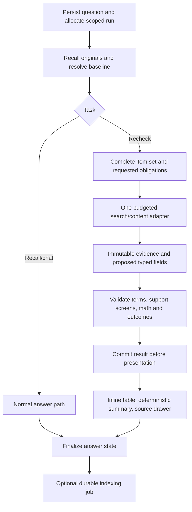

# Lean end-to-end implementation plan

Version 0.4 — 12 November 2026 — current authoritative proposal, not approved for coding.

Read E2E_DESIGN_REVIEW.md for the paper walkthrough, specific failure conditions, removed features and remaining uncertainties. This document supersedes conflicting scope in SYNTHESIZED_PLAN.md, CHAT_BOARD_PLAN.md and CONTRACTS_AND_BACKLOG.md. The repository comparisons remain evidence/reference documents, not a mandatory feature list.

## 1. First-submission scope

Deliver a reliable chat agent with dated original-history recall and evidence-based rechecks. Interface: conversation sidebar, chat/composer, expandable inline comparison table and original/evidence drawer. Keep saved checks reachable from their original chat; no standalone dashboard.

Required: TypeScript/Node, local SQLite original log and FTS/date indexes, one model-callable web_search tool, one configured search provider and model, evidence-linked comparable claims, item/claim accounting, bounded requests, cancellation/retry/restart correctness and a meaningful evaluation report. Confirm original challenge wording and exact dependency/provider contracts before implementation.

Remove from MVP: charts, quantity sliders, general memory editor/forgetting, profiles/open loops, embeddings, universal quote syntax/text-fragment links, archives, provider fallback chains, monitoring and agent frameworks. Keep chat deletion and normal conversational corrections. A narrowly scoped indexing worker may improve retrieval but never blocks raw original-history recall.

## 2. Minimal integrated architecture

Do not force ordinary conversation into structured price output. Rechecks use structured candidate fields and code-generated outcomes; ordinary chat may stream text. Progress streams immediately, but factual recheck conclusions wait for validation and commit.

## 3. Data and identity contract

Use scoped conversations, original messages, runs, source observations, decision/member snapshots, claims/obligations/outcomes, and one optional indexing-job record. These are conceptual responsibilities; a compact schema may combine compatible records rather than create a table for every noun.

- Original question saved before network/recall failures; answer has complete/partial/cancelled/failed status.
- Run has owner, conversation, question, unique client request key, deadlines, usage and terminal version.
- Decision snapshot links original text, members, constraints, revision and assistant-proposed/user-shortlisted/user-selected provenance.
- Member/plan identity is local to its actual decision context. Plan rename/equivalence requires evidence; no automatic text-similarity merge.
- Observation preserves returned content and observation metadata; publication/capture/effective dates stay separate and nullable.
- Outcome references baseline/current evidence and validated fields, unresolved reasons and code-computed totals. Search attempted is not verified.
- Indexing jobs distinguish failure from successful empty extraction and are idempotent per turn/version.

Append corrections; never overwrite what was originally said. Store partial text for display only, excluding it from completed factual indexing. Retain demo data in a separate namespace. Deletion cancels dependent work and blocks stale writes using a deletion-generation check; delete derived payloads and invalidate dependent result references.

## 4. Baseline creation and retrieval

When a recommendation is first made, save all original text and evidence immediately. Validate/store a structured member snapshot if the response supplies it. Do not require background extraction to finish for the next turn.

For rechecks, retrieve using date/FTS/recent references and decision aliases, then expand the actual original exchange. If structured memory is absent, perform on-demand interpretation of the full relevant original within budget. If the member set or intended revision remains ambiguous, ask one targeted clarification before research. Never substitute a newly researched shortlist for missing historical memory.

Resolve dates against injected time and IANA zone, with local calendar-day boundaries. Keep alternative weekdays when reasonable. Matching history can narrow a choice, but a topic on another date must not silently replace the requested date. Report lookup scope and truncation; expand every selected member even if candidate recall was capped.

## 5. Recheck execution

1. Establish which original proposal/decision and constraints apply.
2. Create obligations only for requested attributes: price, relevant limit or dated release. Account for every item.
3. Allocate a fair initial current-state batch. Run dated-change searches only where timing or launches are requested; no publication cutoff on evergreen current pricing.
4. Register immutable evidence and acquisition failures.
5. Extract proposed fields with actual evidence spans. Validate identity and relevant comparison dimensions; unresolved or contradictory support stays unresolved.
6. Refine only important gaps within remaining call/query/time budgets.
7. Compute aligned prices/totals in code; choose permitted outcomes.
8. Commit the typed result and answer state transactionally before presenting completed rows and summary.

Outcomes: confirmed post-baseline change; different now/timing unknown; same observed value; earlier answer wrong; cannot compare/verify; no saved baseline. Known historical error requires reliable historical evidence. No result does not mean unchanged; same endpoints do not establish continuous stability.

MVP arithmetic handles explicitly evidenced flat per-unit plans and simple commitment conversion. Tiered, negotiated, usage-based and mixed-currency comparisons stay explained formulas or unknown unless fully supported. No imaginary discounts, taxes, seat minimums or plan-equivalence assumptions.

## 6. Budgets and model calls

Every synchronous model request—including baseline extraction, repair or support review—counts in one ledger. Default maximum: four model calls, twelve queries, three query batches, concurrency three and 120 seconds overall; proposed acquisition cutoff at 100 seconds. These are initial ceilings, not speed guarantees.

Use deterministic query construction for clear recovered entities, with model refinement only for gaps. Typical recheck: optional baseline interpretation → acquisition → typed extraction → optional focused refinement/repair → code-generated result. No compulsory planner, final prose writer or critic. Ordinary chat normally uses one model call and no search when current facts are unnecessary.

If the budget cannot resolve everything, produce an honest partial-coverage result. If validation/storage cannot safely finish, keep failed/interrupted state. Background indexing has separate usage accounting and bounded retries.

## 7. Concurrency, streaming and recovery

MVP permits one active generation per conversation; simultaneous submissions receive a clear busy response rather than silently race. Other conversations can run within a global configured concurrency bound. Duplicate client request keys reconcile the same run without reissuing provider calls.

Events carry run/conversation IDs and sequence; browser ignores obsolete events and reconciles live/saved messages by stable IDs. Store final results before completion events. Cancellation and completion use compare-and-set terminal transitions; a late cancel cannot undo a completed committed result.

Disconnect/cancellation propagates to active work. Client reload uses persisted run state; no automatic billable replay. Startup marks interrupted generations and recovers only indexing leases. Retrying a question creates a new linked attempt, preserving history.

## 8. UI contract

Chat shows original messages, concise progress, resolved baseline chip, final summary and expandable rows. Each row includes original/current terms, permitted outcome, cost effect if calculable and evidence/gap link. Header distinguishes total items, attempted searches and resolved requested obligations.

Source drawer shows exact saved excerpt, its historical/current role, available dates and relevant field spans. Opening the live URL is separate from inspecting historical saved content. Original-turn links show the baseline proposal and revisions.

Mobile uses stacked rows; keyboard access, focus management and status text are required. No chart or numerical-confidence badge. A labeled fictional offline walkthrough can demonstrate behavior without keys; it must never contaminate live history or evaluation claims.

## 9. Build order and acceptance gates after approval

| Stage | Work | Must pass before proceeding |
| --- | --- | --- |
| 0. Freeze | Brief, runtime/library/provider contract confirmation; single candidate model/provider, deadline and spending envelope; explicit user approval | No implementation until recorded approval. |
| 1. Durable conversation | Scoped SQLite originals, run state/idempotency, minimal chat/SSE, cancel/retry | Question survives error/restart; one active run; no duplicate billable calls on repeated request. |
| 2. Historical recall | Zoned dates, date/FTS/recent retrieval, original expansion and proposal/revision state | Correct day and five-member set, user vs assistant provenance, pending-index follow-up, ambiguous-baseline clarification. |
| 3. Search and evidence | Single adapter/tool, fair batches, metadata/content registry and budget | Failures/unknown capture age explicit; historical observations remain intact; abort/deadline respected. |
| 4. One verified vertical slice | Typed fields, obligations, comparison rules and deterministic table | Five fictional items exercise valid change, mismatched terms, same observation, evidenced historical error and missing source. No unsupported conclusion. |
| 5. Integration hardening | Commit-before-emit, stale-event checks, deletion generation, minimal durable indexing | Cancel/complete race, two tabs, disconnect/retry, delete-while-working, restart and failed-vs-empty extraction behavior. |
| 6. Quality and delivery | Controlled development/held-out evaluation, separate live acquisition check, source review, clean setup/docs/video | Results include failures, denominators, supported-answer latency and costs; no universal superiority claims. |

Start with the vertical slice and failure invariants, then broaden categories. Do not build a finished dashboard before verification works. Compare internal simpler baselines and Thread if runnable under documented settings; other cloned systems are optional targeted comparisons, not a prerequisite to shipping.

## 10. Definition of done and remaining limits

Complete means the brief runs from a clean checkout, original history and source evidence persist, every requested item is accounted for, comparable arithmetic is correct, unsupported conclusions remain unknown, cancellation/deletion/restart contracts work, and evidence of quality is documented. Selection remains outside our control.

Unproven until execution: semantic source interpretation, live freshness/content coverage, exact provider/model compatibility, real latency/cost and performance against references. Planning supplies safeguards and test obligations; it cannot honestly declare them passed.
