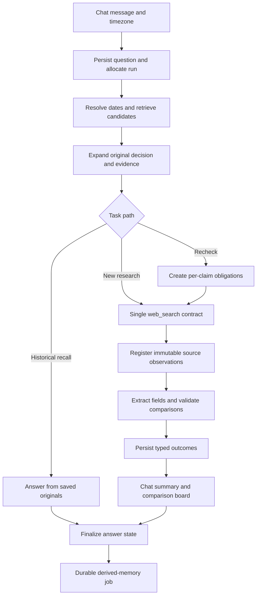

# Integrated implementation plan from nine reference implementations

> Version 0.4 scope review: [LEAN_IMPLEMENTATION_PLAN.md](LEAN_IMPLEMENTATION_PLAN.md) and [E2E_DESIGN_REVIEW.md](E2E_DESIGN_REVIEW.md) take precedence. This document preserves earlier design/source context; its optional and product features are not all approved MVP requirements.

Version 0.3 — 12 November 2026 — planning only; implementation approval has not been given.

This was the version 0.3 build proposal and is superseded by version 0.4. It supersedes architectural choices in the earlier IMPLEMENTATION_PLAN.md where they differ. FEATURE_SELECTION.md supplies the source-to-feature mapping; IMPLEMENTATION_AUDIT.md records pinned revisions and evidence limits; CHAT_BOARD_PLAN.md specifies the product interface; EVALUATION_PLAN.md defines comparisons and metrics.

## 1. What we are building

A conversational research assistant with persistent memory and a comparison board for revisiting past recommendations. It answers ordinary questions, finds old questions and answers across chats, researches current information, and checks whether a previous decision still makes sense under its original constraints.

The main demonstration: shortlist five fictional CRM tools for a 20-person team on a simulated Monday; return later; recover all five and their terms; recheck current evidence; identify a comparable price change, a billing mismatch and a missing source; show the effect on team cost only where justified. Fictional demo data and live evidence remain unmistakably separate.

The differentiator is the integrated verification contract: each original item survives retrieval, each relevant claim has a tracked obligation, every computed comparison checks relevant terms, and the answer and board share the same evidence-linked outcome. We are improving enforcement and demonstrating reliability, not claiming memory/citations are new inventions.

## 2. Submission constraints and scope

Use TypeScript on Node. Required startup remains npm install followed by npm run dev. Expose exactly one model-callable tool, web_search; internal retrieval, validation, arithmetic and job processing stay in application code. Document server-only keys in .env.example. Produce a public original repository, a one-page DESIGN.md and the explanation video described in the supplied research. Confirm original challenge/application wording before freezing delivery scope.

Core: persistent chat, date/topic recall, exact decision membership, evidence retention, one bounded search loop, typed rechecks, comparison board, inspectable sources, explicit unknowns, restart/cancel recovery, evaluation and a labeled offline walkthrough.

Conditional additions: semantic recall if held-out paraphrases miss; price chart only with comparable numeric observations; derived-memory forgetting controls after the deletion/suppression contract works.

Deferred: recurring alerts, MCP memory server, autonomous monitoring, graph database, agent swarm, arbitrary chart generation, uploads/voice and several provider fallbacks. The user-facing workspace is detailed in CHAT_BOARD_PLAN.md; it is not a general analytics dashboard.

## 3. Stack and architectural choices

| Layer | Proposed choice | Reference influence / reason |
| --- | --- | --- |
| Runtime | Node 24+ candidate, strict TypeScript | Thread's low-service setup. Confirm current runtime/driver support before implementation. |
| Backend | Express, a small agent service, SSE | Thread's lifecycle plus Anu's transport-independent core. |
| Storage | Local SQLite, transactions, FTS5 and normal indexes | Durable original log with rebuildable derived memory; no external DB service required. |
| UI | React/Vite, standard Markdown rendering, typed widgets | Thread evidence panel + Scout progress + Divyendra stream reconciliation. No custom Markdown parser for tables. |
| Dates | Luxon-style zone-aware calendar operations plus natural-language parsing | Thread's timezone boundary discipline and ambiguity handling from ashusnapx/Harshdip. Exact packages/versions need documentation confirmation. |
| Validation | Runtime-validated records and provider outputs | Suraj's checks, upgraded from prose-derived outcomes to typed records. |
| Model | One configurable primary provider/model | No automatic planner/critic chain. Select exact model under frozen quality/cost criteria. |
| Search | One default adapter, provisionally Tavily; Exa comparison candidate | Retrieved content must fit the one-tool boundary. Provider contract/freshness pilot may change the default. |
| Background jobs | SQLite job table, one bounded worker | ashusnapx responsiveness + Divyendra rebuildability + recovery beyond Scout's in-process queue. |

No implementation dependency is installed yet. Package versions, model response-schema compatibility and exact provider parameters remain explicit pre-build checks. Frameworks remain alternatives, not additional layers beside the small loop.

## 4. One set of contracts

Every request carries owner/workspace, conversation, question and run IDs. Every streamed event carries run ID, conversation ID and increasing sequence. Every evidence reference resolves through the same owner-scoped registry. A comparison board is a view of a verification run, not a separate model answer or second truth store.

## 5. Persistence design

| Record | Required fields / relationships |
| --- | --- |
| Conversations | ID, owner, title, created/updated timestamps, demo/live namespace. |
| Questions and answers | IDs, conversation/owner/run, original text, UTC timestamps, original timezone, role, answer completion state. |
| Runs | Client request ID, task type, baseline ID, lifecycle state, deadline, usage, errors, finalization version. |
| Decisions | Original turn/span IDs, ordered members, constraints, revision and supersedes link; candidate vs user-confirmed state. |
| Entities/plans | Stable identity, aliases, canonical product/plan association; no first-token identity shortcut. |
| Source observations | ID, original/canonical URL, returned passage/content, provider/query, retrieval time, capture/publication/effective metadata if supported, hash, acquisition/freshness state. |
| Claims and fields | Original claim text/span, entity/plan/attribute, proposed typed value, units/terms, source observation/span references, validation state. |
| Verification obligations | Run, decision member, baseline claim, required dimensions, search/evidence/comparability/resolution states, unresolved reason. |
| Outcomes | Baseline/current observation IDs, aligned dimensions, verdict, supported timing, computed totals/delta, reason codes. |
| Derived memories/indexes | Kind, text, entity/decision links, source turn, extraction version and supersession; FTS/date indexes. |
| Jobs and suppressions | Job state, turn/version key, attempts, next retry, lease expiry/error; forgotten-memory suppression records. |

Persist the question and run before recall/provider work. Finalization and outcome persistence are transactional and idempotent. Unique owner/client-request keys prevent retry duplicates. Completed evidence and history are append-only; corrections create new versions.

Store stopped answer text as partial only if useful to revisit it. Partial/cancelled/failed answers are excluded from factual extraction and recommendations. On restart, mark interrupted runs accurately and recover expired jobs. Do not automatically replay potentially billable generation.

Deleting a chat transactionally removes its searchable material and linked pending jobs; retained cross-chat references must become unavailable or be revalidated, not expose orphan text. Forgetting derived memory is different: keep the chat but suppress that memory during later extraction/reindexing. Respect owner and demo namespaces in every query.

## 6. Memory pipeline

1. Resolve explicit dates and relative phrases against an injected clock and user IANA timezone. Represent local calendar windows with exclusive UTC ends; do not assume every day is 24 hours.
2. Keep historical reference time separate from the comparison endpoint. For “3 November, still correct today,” retrieve 3 November.
3. Keep plausible weekday candidates. Use topic and matching conversations to narrow them; state the chosen date. Ask only if the ambiguity changes the baseline and remains unresolved.
4. Retrieve date, FTS, entities and recent conversational references. Return compact candidates with matched reasons, total/bounded counts and omitted scope.
5. Expand the chosen original exchange, nearby references, decision members and relevant sources. Candidate caps must not silently truncate the selected shortlist. If originals are too long, extract relevant spans and declare omitted material; use a scoped clarification if the necessary baseline cannot fit.
6. Use recent original messages when extraction is pending/failed. Empty extracted memory does not establish missing conversation history.
7. Keep revisions distinct: “we compared five” and “we chose three” describe different sets. Resolve which set the current question refers to.
8. Add semantic retrieval behind the same contract after a measured lexical miss. Fuse rankings rather than mixing incomparable raw scores. Do not block startup or basic recall on an embedding download/service.

Acceptance: correct dated original turn, all five members, original team size, latest applicable revision, immediate follow-up without completed extraction, and an honest lookup-scope statement on missing history.

## 7. Task routing and bounded search

Routing is lightweight application logic informed by the current turn and recovered context; uncertain cases remain model-directed within the same loop. Do not depend solely on a short freshness-keyword regex.

- Casual conversation: one normal model response, no compulsory search.
- Historical questions: answer from originals; do not fetch current prices when the user asks what was said then.
- New current-world research: model may call web_search, results become observations.
- Rechecks: baseline and obligations are required first. A clear saved shortlist permits an initial application-planned batch through the same search service, avoiding a redundant planner round trip. The model can refine genuine gaps.

The only exposed tool accepts a bounded batch of queries with purpose, optional domains/publication windows and freshness intent. Results include per-query success/failure and observations. No separate model-callable browser, fetch, memory or arithmetic tool is added. Application-planned search does not create another tool surface.

Starting ceilings: three research rounds, twelve queries, concurrency three, four main model calls and a 120-second wall-clock ceiling. Share an abort signal across acquisition, model and streaming. These are adjustable limits, not latency promises.

For a five-vendor recheck, first allocate current-state coverage fairly, then dated-change searches when requested, then spend remaining budget only on important gaps. An obligation can remain unresolved; never exceed budget merely to make the board look complete. Interleave returned evidence across items so an early query cannot monopolize context.

Separate ordinary cached information from live rechecks. Rechecks bypass the application result cache and request fresh provider acquisition when supported. Preserve returned capture age and unknown/fallback status. A new request alone is not proof of newly captured content. Read fuller provider-returned content selectively when snippets miss essential terms.

## 8. Verification pipeline

### Baseline and obligations

Recover original assistant claims and the evidence supporting them. An old answer proves what the assistant said, not historical truth. Imported text without historical excerpts is labeled accordingly. Do not assign a historical source capture date from an import timestamp.

Create stable obligations for each relevant entity/plan/attribute. Each independently records attempted acquisition, usable evidence, comparison prerequisites and resolution. One query may resolve several obligations only if its evidence supports each. All original members appear in the final board, even if no claim was resolved.

### Current pages and dated events

Current pricing/product pages establish present observations. Dated announcements establish transition/release timing. Search them separately. Do not restrict current pricing pages to publications after baseline. Prefer official sources; keep conflicting versions visible. Historical archive use is a bounded fallback, conditional on actual capture coverage.

### Typed extraction and comparison

The model proposes fields and supporting passage IDs/spans. Validate object shape, referenced text existence, entity/plan association, units and arithmetic prerequisites. Passage presence and vendor-name matching are screening checks, not complete semantic entailment. Use an additional targeted review only for high-impact ambiguous cases if it earns its cost.

For a price, retain amount, currency, product/plan, unit, billing interval/commitment, quantity and relevant region/tax/minimum/allowance/promotion qualifiers. Do not require irrelevant dimensions just to fill a schema. Do not guess missing qualifiers.

Compute team totals and deltas in code with decimal-safe representation. For a flat 20-seat annual commitment, calculate only after confirming the per-seat basis and applicable minimums. Tiered/usage/negotiated plans remain formulas or unknowns unless enough structure is known. No automatic cross-currency conversion.

Outcomes: confirmed change after baseline; different now with timing unknown; same observed value; earlier answer wrong; cannot compare/verify; no saved baseline. Date-based changes require evidence of timing, not just a newer observation. Missing search results never establish unchanged.

### Validate before presentation

For rechecks, obtain a structured final payload using the selected model's supported response contract; this is a response format, not a second tool. Validate outcomes and downgrade unsupported fields to unresolved before emitting factual comparison rows. Render rows and arithmetic deterministically. Progress can stream early; comparison conclusions must wait for validation.

A concise narrative may explain the validated results and their relevance to original constraints. Prevent narrative/table contradictions with deterministic summary templates for counts and price changes, plus checks on any model-proposed recommendation. Do not promise that schema validation makes qualitative reasoning infallible.

## 9. Chat workspace and board

The browser has a conversation sidebar, central chat and on-demand evidence drawer. A saved recheck adds an inline comparison preview and an expandable board. The board shows baseline date/constraints; one row per item; old and current facts with billing terms; outcome; unresolved reason; evidence; and the team's cost effect where calculable.

User actions: open original exchange, inspect evidence, filter unresolved/changed items, recheck all or unresolved items, stop, retry and revisit saved runs. A recheck creates a new immutable run; it never rewrites the original result. Changing team size creates a visibly separate scenario calculation, not a new historical claim.

Charts are optional views of eligible observations from that same data. Use grouped before/after bars for aligned numeric costs. Show two known points as observations; do not draw a continuous history or fill missing values with zero. Preserve a readable table alternative. See CHAT_BOARD_PLAN.md for interaction/error/mobile details.

## 10. Streaming, API and recovery contracts

API responsibilities: readiness; conversations/messages; create/stream a run; cancel a run; read a verification result; inspect original baseline/evidence; list derived memory; scoped deletion/forget; explicit recheck. Server-owned configuration only; readiness exposes booleans/labels, never key values.

Events: run-started, recall-found/needs-clarification, search-progress, observation-added, outcome-validated, answer-delta for eligible content, run-completed/cancelled/failed. Include stable IDs and sequence. The client reconciles saved/live records by IDs and ignores events from obsolete run generations. Conversation switching cannot append text to the wrong chat.

Persist final state before sending completion. If streaming disconnects, a run lookup reconciles actual status; do not start a duplicate run automatically. Cancellation must be idempotent and propagate across searches. On provider failure, retain the user question and honest partial coverage. A retry starts a linked new run using the existing question.

## 11. Durable enrichment and memory controls

Create an extraction job in the answer-finalization transaction for completed eligible turns. Process at most one initially, using leases and idempotency keys for turn/extractor version. States are pending, leased, retryable failure, permanent failure, complete-empty and complete-with-memories. Use bounded backoff; keep failed jobs inspectable and raw recall available.

On restart, expired leases become retryable. A failed extraction is not marked successful with an empty result. Track suppressed/forgotten memories so a reindex does not silently restore them. User-stated preferences, proposed decisions and sourced assistant claims have distinct memory kinds and evidentiary requirements.

## 12. Implementation work packages after approval

| Package | Dependencies | Deliverable | Acceptance evidence |
| --- | --- | --- | --- |
| WP0: freeze | Planning | Confirm brief, exact dependencies/provider contracts, model/default selection rule, deadline and cost ceiling | Decision record and explicit user approval; no scaffold before this. |
| WP1: original log and lifecycle | WP0 | Owner-scoped DB, migrations, questions/runs, SSE, minimal composer, readiness | Clean install/start; question survives provider error; duplicate request/cancel/restart tests. |
| WP2: recall | WP1 | Calendar windows, FTS/entity/recent candidates, full decision expansion, baseline inspector | Date/timezone, wrong-week, revisions, five-item and pending-extraction cases. |
| WP3: search/evidence | WP1 | Single validated tool, fair batches, observations, citations, deadlines | One-tool trace; failure/abort/budget handling; old evidence remains distinct. |
| WP4: verification | WP2 + WP3 | Claims/spans, obligations, price normalization, verdict rules, typed result | Billing/currency/seat/promotion fixtures; every item has outcome or unknown. |
| WP5: board and evidence UI | WP4 | Comparison board, filters, evidence drawer, original links, run history | Board/chat agreement, reload, mobile/keyboard and stale-event checks. |
| WP6: enrichment and controls | WP1 + WP2 + WP3 | Durable jobs, versioned indexes, rebuild, scoped suppression/deletion | Extraction failure/restart and forgetting/reindex tests; no incomplete factual indexing. |
| WP7: conditional enhancements | Stable WP2/WP5 | Semantic retrieval and eligible comparison charts | Measured recall improvement; no unsupported chart conversions/history. |
| WP8: evaluation and delivery | Core complete | Controlled/live results, setup/docs, one-page DESIGN, demo/video | Frozen held-out rubric, repeat runs, cost/latency disclosures, clean checkout. |

Provisional effort: 7–10 focused working days including review and evaluation, depending on API access and submission deadline. Work packages can share prerequisites, but no agent swarm or parallel implementation is assumed. If compressed, remove WP7 and memory editing conveniences before removing core verification, recovery or tests.

## 13. Verification and proof of improvement

Use EVALUATION_PLAN.md's 60-scenario proposal, with a frozen development/held-out split. Add scenarios for live-vs-saved UI reconciliation, delayed job restart, complete-empty vs failed extraction, forgetting/reindexing and chart eligibility. Keep model/evidence/budget comparable for architecture ablations; report reference configuration differences separately.

Critical failures have zero tolerance in designated fixtures: fabricated history, silently omitted members, invalid numeric comparisons, invented change dates, unsupported chart points, cross-owner exposure and incomplete answers indexed as completed facts. Measure retrieval, claim support, uncertainty and latency separately. Stream-start time is not supported-answer time.

A project can have all these modules and still lose on source extraction or conversation quality. Review actual answers and source support, not only schemas, keywords or test counts. Demonstrated improvements must name the measured workload and tradeoffs; do not claim guaranteed selection.

## 14. Remaining uncertainties and approval boundary

Source review now covers meaningful backend/memory/search/lifecycle/UI paths across all nine clones, with selected tests read. It is not every source line, a complete security audit or runtime validation. No dependencies were installed and no reference benchmarks were executed. Conventional license discovery remains preliminary; no code was copied.

Before implementation: verify original challenge wording, exact provider/runtime/library contracts, timeline and spending constraints, and review the chosen plan with the user. Record explicit approval in DECISIONS.md. Provider/model pilot outcomes may select among already approved candidates after implementation begins; they cannot honestly be settled by README inspection.
